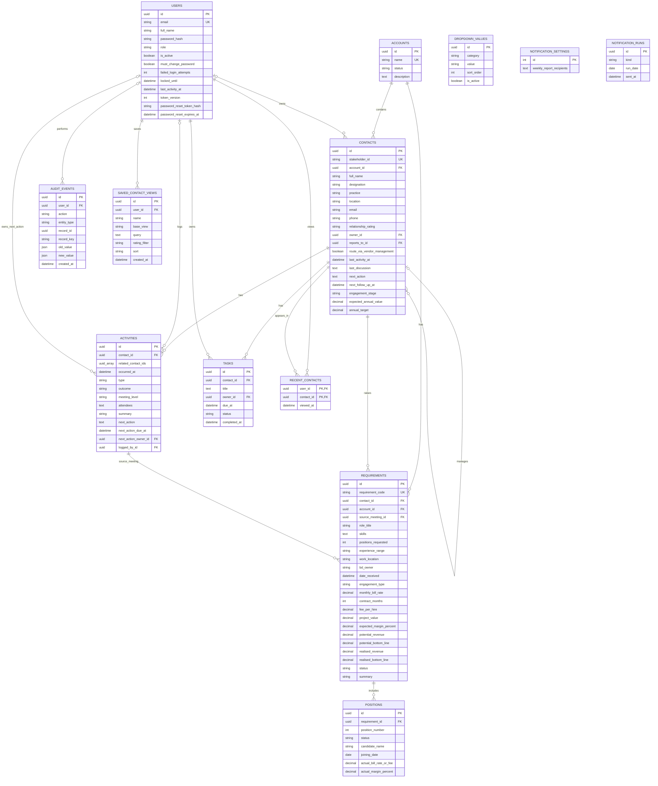

# BD CRM — tentative database schema

This diagram reflects the current FastAPI / SQLAlchemy models. It is a review draft: confirm field rules, retention, and reporting needs with the business team before treating it as the production contract.

## Relationship notes

- Each contact belongs to one account. A contact can optionally report to another contact and have an assigned BD owner.
- An activity has one primary contact. The model also stores related contact IDs in a PostgreSQL UUID array; this currently has no foreign-key validation.
- A requirement links the requesting contact, account, and source meeting. Its positions are stored as separate rows so each candidate and joining outcome can be tracked.
- A task is a follow-up assigned to a user and associated with a contact. Completing a task records its completion time.
- Audit events keep the acting user when available and store old/new values as JSON. `record_id` is polymorphic, so it intentionally does not point to one table; `record_key` retains readable business IDs.
- Dropdown values are grouped by category. Notification settings and runs are system-level records rather than user-owned rows.

## Review points before production

1. Consider replacing `activities.related_contact_ids` with an `activity_contacts` join table if multi-contact activities need referential integrity or filtering at scale.
2. Confirm whether `requirements.bd_owner` should become a foreign key to `users.id`, rather than storing a display name.
3. Confirm account/contact deletion and retention policy. Current foreign-key rules restrict deleting records used by CRM history, while audit events are append-only.
4. Add database checks or controlled lookup references for role, task status, relationship rating, engagement stage, requirement status, and non-negative commercial values.
5. Confirm currency and precision rules for all commercial amounts before finalizing numeric column precision.
